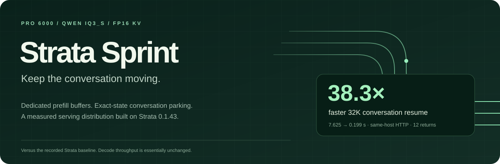
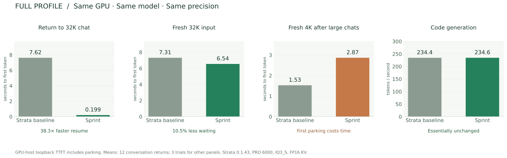

<p align="center"></p>

<p align="center">
  <a href="https://github.com/LongWeihan/strata-sprint/actions/workflows/ci.yml"></a>
  <a href="LICENSE"></a>
  
  
</p>

<p align="center"><b>English</b> · <a href="README.zh-CN.md">简体中文</a> · <a href="https://longweihan.github.io/strata-sprint/">Benchmark explorer</a> · <a href="docs/INSTALL.md">Install</a> · <a href="docs/BENCHMARKS.md">Reproduce</a></p>

# Faster returns to long conversations

**38.3× faster 32K conversation resume than our recorded Strata 0.1.43 baseline**, on the same RTX PRO 6000 Blackwell: **7.625 → 0.199 seconds** to the first token, averaged over 12 returns.

Strata Sprint is a PRO 6000 serving distribution built on **[Strata](https://github.com/Niko1221/Strata)**. Strata supplies the CUDA kernels, model execution, APIs and exact-state conversation cache. Sprint supplies the measured hardware profile, standalone supervisor, configuration checks and public benchmark evidence. Both comparison arms use the **same upstream engine commit**.

**The advantage is workload-specific:** resuming interleaved long chats is much faster; raw token generation is essentially unchanged. First-time conversation parking can make a short new request slower. [Full results, including that regression →](docs/BENCHMARKS.md)

## The numbers



**Same card. Same model. Same precision.** Linux · 20 vCPU · 160 GiB RAM · 97,887 MiB reported VRAM. Target: `SC117/Qwen3.8-Flash-Next-GSQ-RCO-abliterated-GGUF`, IQ3_S. FP16 KV · 131,072 context · MTP draft length 4.

| Full-profile workload | Recorded Strata baseline | Sprint profile | What it means |
| :--- | ---: | ---: | :--- |
| Return to a 32K main conversation | 7.625 s | **0.199 s** | **97.4% less first-token wait** |
| Fresh 32K input in a mixed sequence | 7.310 s | **6.544 s** | 10.5% less wait |
| Fresh 123K input in a mixed sequence | 25.770 s | **25.095 s** | 2.6% less wait |
| Fresh 4K input after larger conversations | **1.526 s** | 2.865 s | First parking costs time |
| Code generation | 234.4 tok/s | 234.6 tok/s | Essentially unchanged |
| Reasoning generation | 223.8 tok/s | 223.3 tok/s | Essentially unchanged |
| Explanatory prose | 164.0 tok/s | 163.6 tok/s | Essentially unchanged |
| Observed peak VRAM | **56.79 GiB** | 60.14 GiB | +3.35 GiB for dedicated buffers |

Times are measured by an HTTP client **on the GPU host**, including engine-side state copy costs. They exclude network transport to a remote user. The baseline is the [exact recorded configuration](profiles/baseline.example.json), with its paths made portable; these are not claims against every possible Strata setup or a newer release.

An isolated buffer-only experiment reduced fresh-input first-token wait by **31.0% / 12.0% / 4.9%** at 4K / 32K / 123K. That is a separate experiment, not the full-profile table above. [449 measurement records →](benchmarks/pro6000-2026-10-12/)

## Why it helps

- **Keep experts resident.** Dedicated 8,192-token prefill buffers avoid lending the expert cache's GPU memory to prompt processing.
- **Keep conversation state.** Four parking slots share a 16 GiB host-memory budget. Returning to a parked history reuses its state instead of replaying the full prefix.
- **Keep room for the system.** A 16 GiB free-memory floor and an explicit host/container RAM cap guard cache admission. Requests below 2,048 tokens do not occupy a parking slot.
- **Keep the measured arithmetic.** Original IQ3_S weights, FP16 KV, MTP 4 and sampling settings stay in place. Kernel flags that changed logits or failed to show a consistent gain were excluded.

All of these engine mechanisms come from upstream Strata. The contribution here is selecting, validating and shipping them together for this hardware and workload.

## Quick start

Run on your **Linux GPU host**, with the tested model and a working Strata 0.1.43 configuration. The runtime has no notebook-provider, desktop-client or bridge dependency.

```bash
git clone --recurse-submodules https://github.com/LongWeihan/strata-sprint.git
cd strata-sprint
python3 -m pip install -e '.[bench]'

# Point at your existing, working Strata config. The input file is preserved.
strata-sprint configure --base /srv/strata/base.json \
  --output /srv/strata/sprint.json --ram-gib 160 --port 8080

strata-sprint doctor --config /srv/strata/sprint.json \
  --engine /srv/strata/source --python /srv/strata/python/bin/python

strata-sprint serve --config /srv/strata/sprint.json \
  --engine /srv/strata/source --python /srv/strata/python/bin/python \
  --state-dir /srv/strata/sprint-state
```

`--engine` is the **clean pinned Strata checkout used by your config**; the bundled `engine/` submodule is that same source revision. `--python` must have upstream's dependencies. The tested profile requires **RTX PRO 6000 Blackwell 96 GB and at least 160 GiB RAM**. Model weights are downloaded separately under their own terms. [Fresh-host setup and build commands →](docs/INSTALL.md)

Use the upstream endpoints at `http://127.0.0.1:8080/v1/chat/completions` or `/v1/messages`. Server APIs and the web interface are upstream Strata's. Set an API key before listening outside loopback.

## Precision evidence

| Check | Recorded result |
| :--- | :--- |
| Selected profile vs baseline output text | **70/70 hashes identical** |
| Non-interleaved first-logit vectors | **49/49 byte-identical** |
| All compared first-logit vectors, top-1 token | **61/61 identical** |
| Separate parked vs uninterrupted session | **Byte-identical first logits and output** |

The 12 cached-versus-cold-recomputed comparisons take different floating-point paths and are **not** byte-identical; all 12 produced the same text in this run. The separate uninterrupted-session control tests the copy itself. These finite checks do not prove universal output equivalence or model capability. Three original math checks hit their 512-token output cap in both arms; they remain recorded, alongside the successful larger-budget follow-up. [Precision methodology →](docs/PRECISION.md)

## Operation and recovery

The standalone supervisor owns one upstream process group. It serializes its own launches, retries confirmed process exits with bounded backoff, cleans up an orphaned native child, and preserves a live or unobservable engine. A stalled HTTP probe alone does not trigger a destructive restart. **Requests are never replayed.** Private generated configuration is written with mode `0600`.

This supervisor is a new extraction covered by CPU fixture tests and Linux CI. The published GPU performance measurements were made before this packaging step with the same engine configuration. They do not establish multi-day production qualification of the standalone wrapper. [Operations guide →](docs/OPERATIONS.md)

## Reproduce, inspect, contribute

```bash
# Run sequentially on an otherwise idle GPU host, once per configuration.
strata-sprint bench --label baseline --output results/local/baseline.json
# Restart the server with the Sprint config, then repeat with a fresh output path.
strata-sprint bench --label sprint --output results/local/sprint.json
python scripts/compare_runs.py results/local/baseline.json results/local/sprint.json

python -m unittest discover -s tests -v
python scripts/check_evidence.py
```

[Benchmark method](docs/BENCHMARKS.md) · [Raw data](benchmarks/pro6000-2026-10-12/) · [Contributing](CONTRIBUTING.md) · [Security](SECURITY.md) · [Changelog](CHANGELOG.md)

## Credits and license

Sprint's additions are [MIT licensed](LICENSE). Strata is by **Niko1221 and the Strata contributors**; its original [MIT notice](STRATA-LICENSE) and source history are retained through the pinned submodule. Upstream includes components from llama.cpp / ggml and other projects with their own notices. The Qwen team and model publishers own their respective model contributions. No weights are bundled. [Attribution and provenance](NOTICE.md)
